# EDA summary (Phase 2)

*Generated by `python -m solvia.pipeline --steps eda`. Every number below is computed by the code.*

## India: solar resource, rainfall and estimated plant location (NASA POWER 2001–2025)

### City ranking (25-year average)

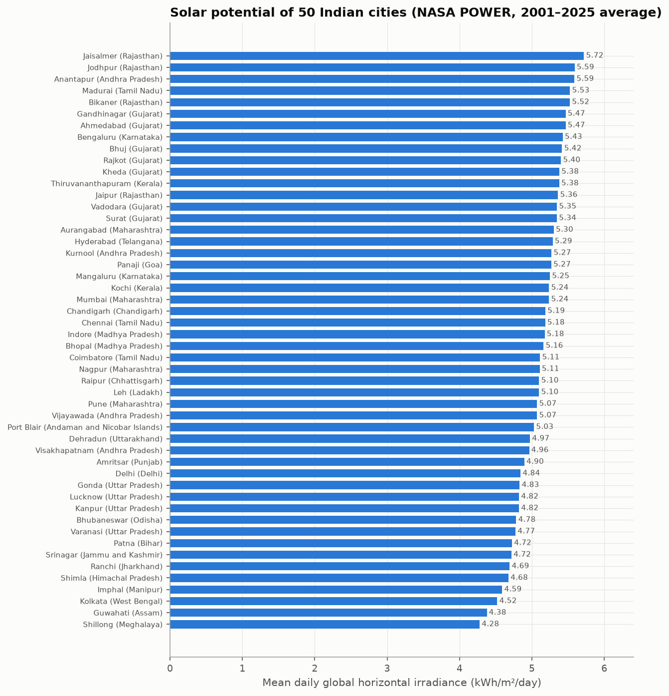

**Takeaway:** Over 25 years the sunniest city is Jaisalmer (5.72 kWh/m²/day) and the least sunny Shillong (4.28); the best region on average is West (5.39) and the weakest North-East (4.41). A 1 kWp system in the top city gets 1.34× the sunlight of one in the bottom city.

### Monthly heatmap

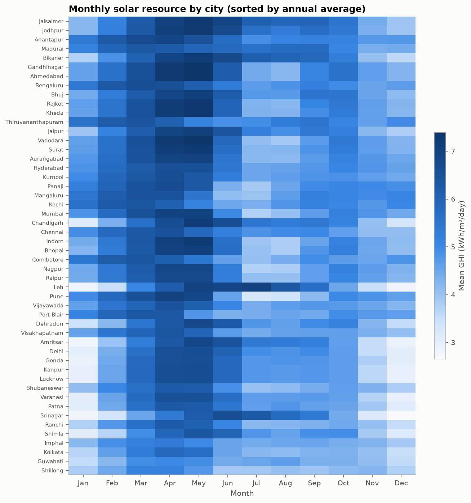

**Takeaway:** 49 of 50 cities have their sunniest month in March–May. 18 are darkest during the monsoon (Jun–Sep) and 32 in Nov–Jan. The seasonal swing ranges from 1.4 kWh/m²/day (Shillong) to 4.2 (Leh), so a monthly estimate is far more honest than one annual number.

### Monthly sun and rain

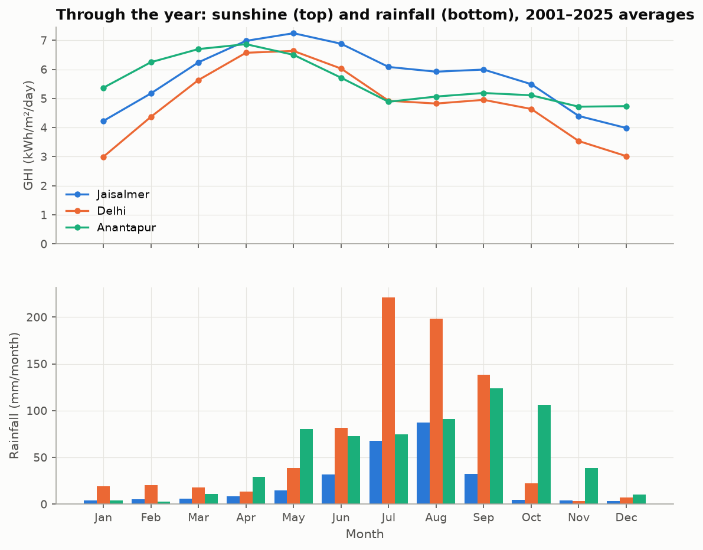

**Takeaway:** Jaisalmer (desert, 269 mm/year), Delhi (782 mm) and Anantapur (645 mm, near the estimated plant location) all peak in spring (May, May, Apr), lose sunshine when the monsoon rain arrives, and are darkest in early winter (Dec, Jan, Nov). The sunny, nearly rainless spring is when dust builds up unwashed.

### Rain and dry months

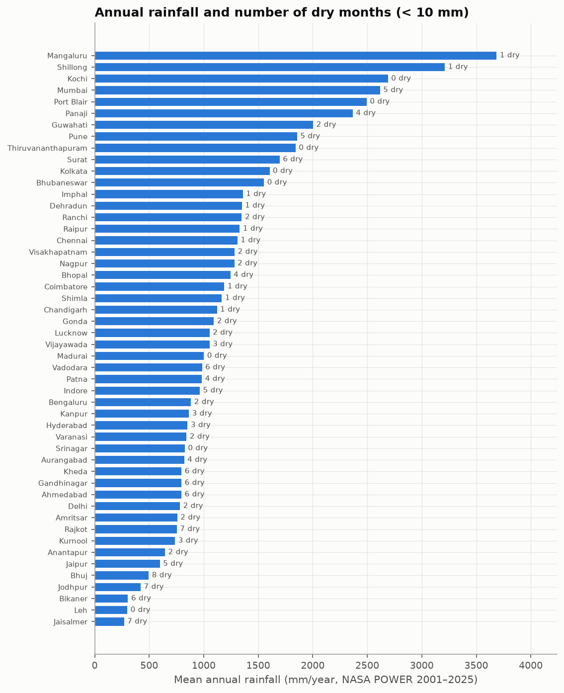

**Takeaway:** Rainfall ranges from 269 mm/year (Jaisalmer) to 3686 (Mangaluru); a median of 82% falls in Jun–Sep. Cities with many dry months (e.g. Bhuj: 8) get no natural panel washing for most of the year, which is when the cleaning rule matters.

### NASA vs NITI

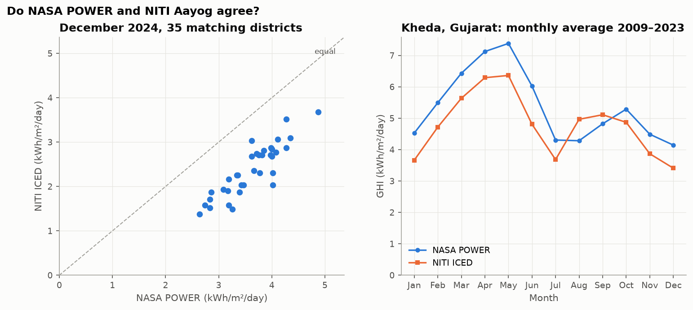

**Takeaway:** For the long-term Kheda averages the two sources agree on the seasonal shape (r = 0.88) and NITI is 0.90× NASA on average. For December 2024 across 35 districts NITI is only 0.67× NASA (rank agreement 0.86), confirming the audit finding that the single-month NITI file reads low; NASA POWER is used for the energy balance.

### Estimated plant location

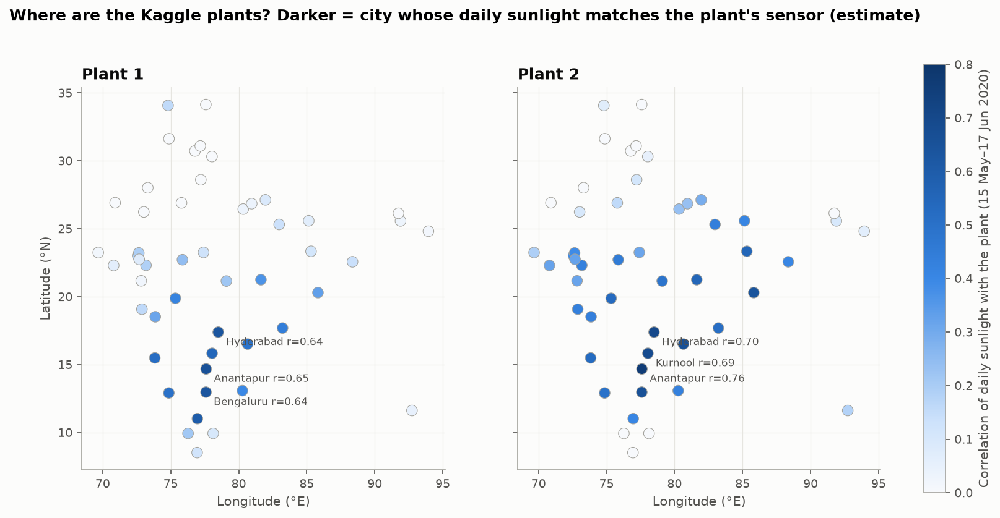

**Takeaway:** Both plants match the southern Deccan plateau best: Plant 1 → Anantapur (r = 0.65, temperature r = 0.87), Plant 2 → Anantapur (r = 0.76, temperature r = 0.86), against a median of 0.12 / 0.32 over all 50 cities. This is an estimate at city resolution, not a confirmed site; NASA rainfall at the best match (84 mm over the 34 days) is used only as labelled 'estimated rainfall'.

### Estimated plant location on a 1° grid

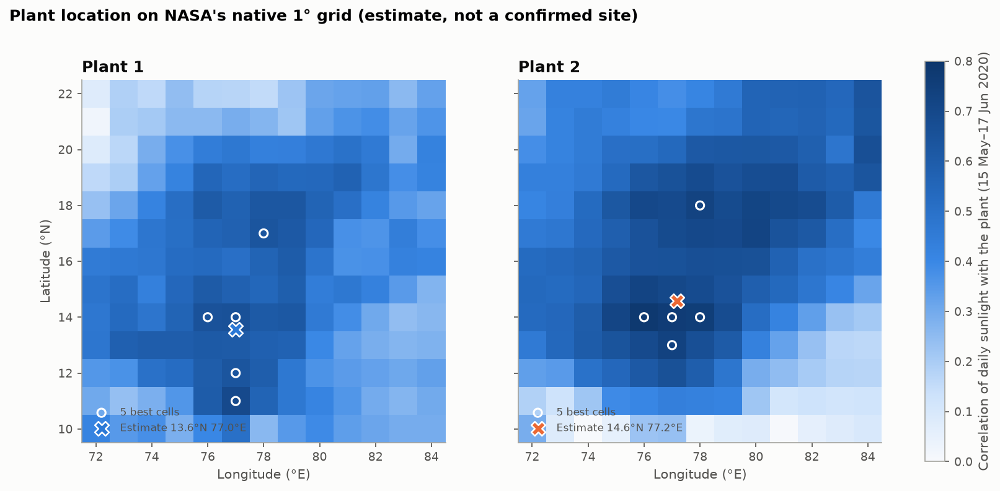

**Takeaway:** On 169 1° cells (10–22°N, 72–84°E) the r-weighted centre of the 5 best cells is 13.6°N 77.0°E for Plant 1 (best r = 0.70, 3 cells within 0.05) and 14.6°N 77.2°E for Plant 2 (best r = 0.78, 4 cells within 0.05), both in the southern interior Deccan and consistent with the city match (i07). Plant 1 is the less certain of the two; 34 days cannot pin a site more precisely than a region.

### District ranking

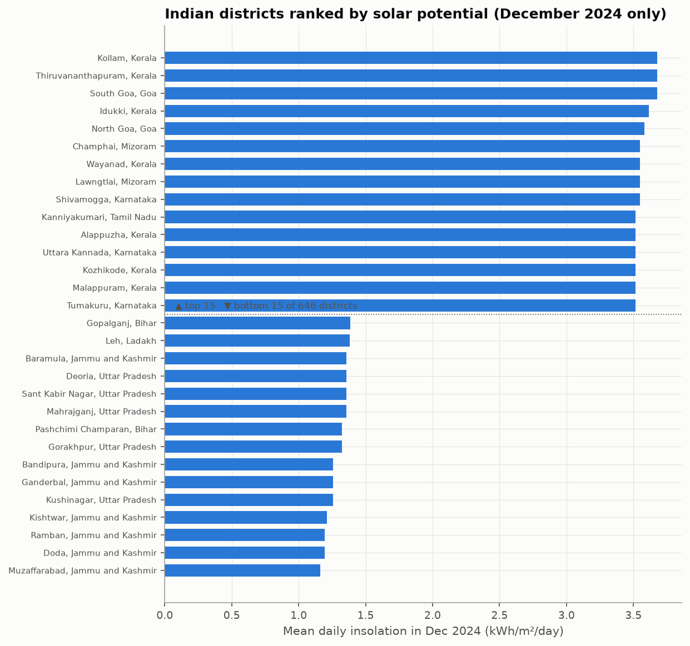

**Takeaway:** In December 2024 the sunniest district was Kollam (Kerala, 3.68 kWh/m²/day) and the least sunny Muzaffarabad (Jammu and Kashmir, 1.16); one winter month only, so use it to rank, not as an annual value.

## Indian households (Prayas eMARC smart meters, Maharashtra + Uttar Pradesh, 2018–2020)

### Who is in the eMARC sample

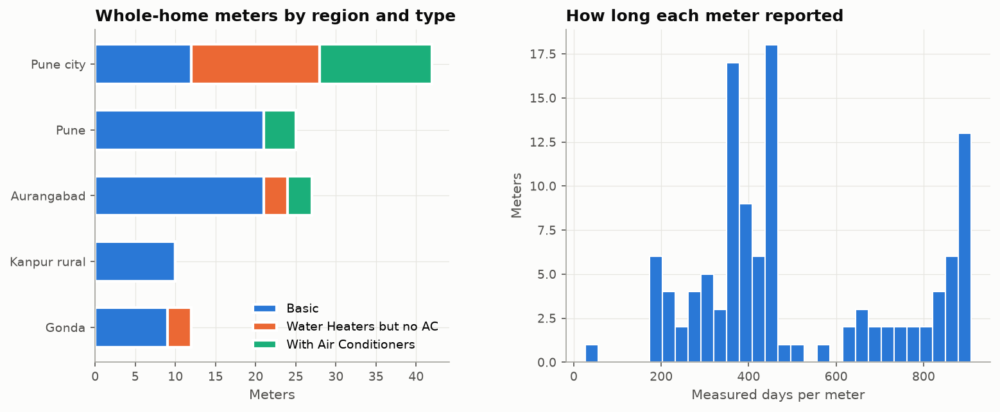

**Takeaway:** 116 whole-home meters with measured data (94 in Maharashtra, 22 in Uttar Pradesh), 116 households. 73 are 'Basic' homes, 22 have water heaters and 21 have air conditioners (all in Pune city, Pune, Aurangabad). Half the meters reported for at least 442 days (84 for a year or more).

### Daily use by household type

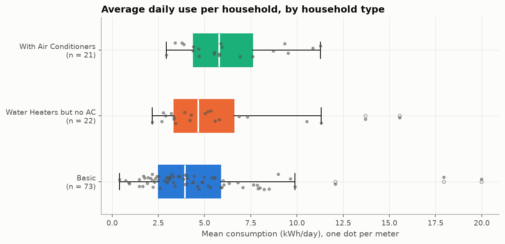

**Takeaway:** The typical (median) household uses 3.9 kWh/day in a Basic home, 4.7 with a water heater and 5.8 with AC. Spread within each group is wide (0.4–20.0 kWh/day overall), so the household's own history matters more than its type label.

### Seasonal pattern by region

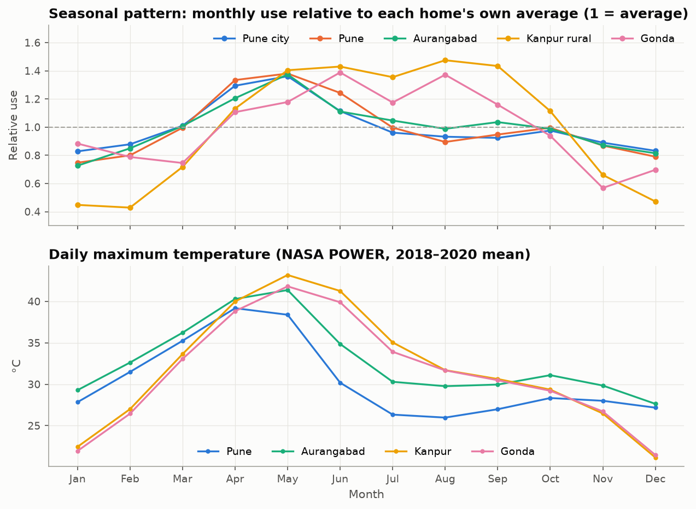

**Takeaway:** Use peaks in the hot months, not in winter as in France: peak month is Aurangabad May (1.37×), Gonda Jun (1.39×), Kanpur rural Aug (1.47×), Pune May (1.38×), Pune city May (1.36×); the lowest month is Aurangabad Jan, Gonda Nov, Kanpur rural Feb, Pune Jan, Pune city Jan. Only meters with ≥ 300 measured days (97) are used. Cooling (fans, coolers, AC) drives the seasonal cycle, so temperature features should matter more here than for the French household.

### Temperature response

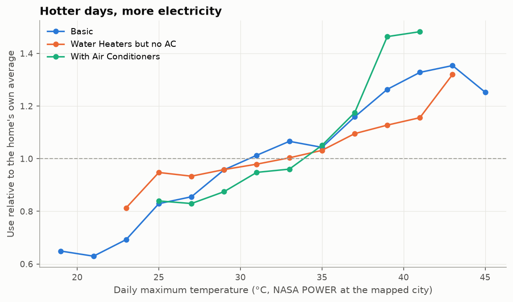

**Takeaway:** Above 30 °C each extra degree of daily maximum adds about 2.9% of a Basic home's average use, 2.0% for water-heater homes and 6.2% for AC homes. Per meter, the median correlation between daily use and maximum temperature is 0.45 (92% of meters positive). Cooling degree-days are therefore included as features.

### Daily load shape and the solar window

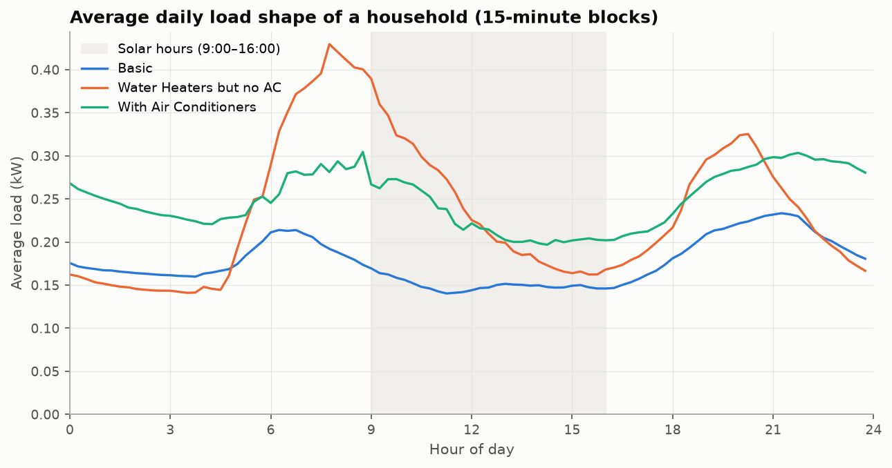

**Takeaway:** Only 25% (Basic), 29% (water heater) and 26% (AC) of daily use falls in 9:00–16:00 when rooftop solar produces most. The peak is at 21:15, 7:45, 8:45 respectively. Without a battery, most solar output in these homes would be exported, not used directly; the energy balance therefore reports this share alongside the daily totals.

### Lockdown shift (test-set warning)

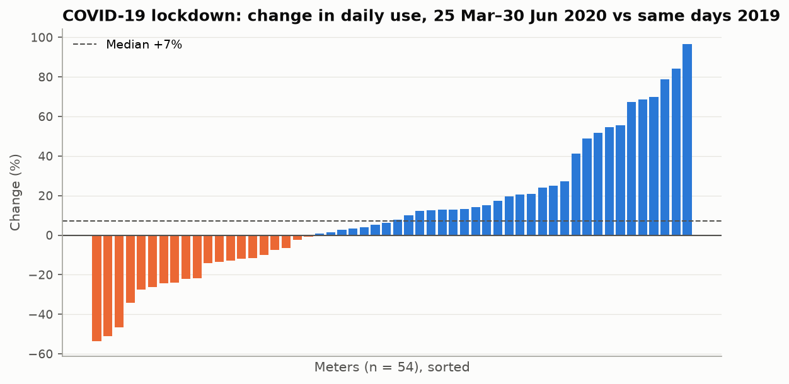

**Takeaway:** For the 54 meters with ≥ 60 measured days in both windows, median use changed by +7% (63% of homes used more; not adjusted for the two years' different weather). The model never sees a lockdown in training, so test results are reported separately for 'normal' days (Jan–24 Mar 2020) and 'lockdown' days.

## Solar plants (Kaggle, India)

### Daily power curves

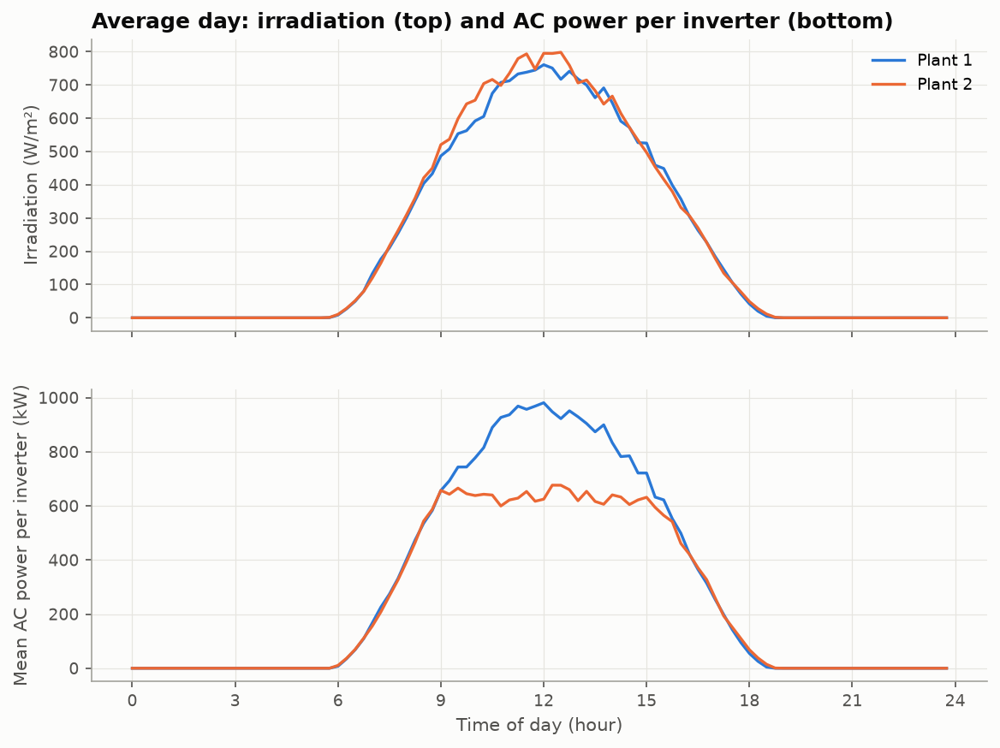

**Takeaway:** Output follows the sun: zero at night and peaking around midday (Plant 1 mean peak 981 kW per inverter, Plant 2 676 kW); Plant 2's lower midday output despite similar sunlight hints at outages.

### AC power vs irradiation

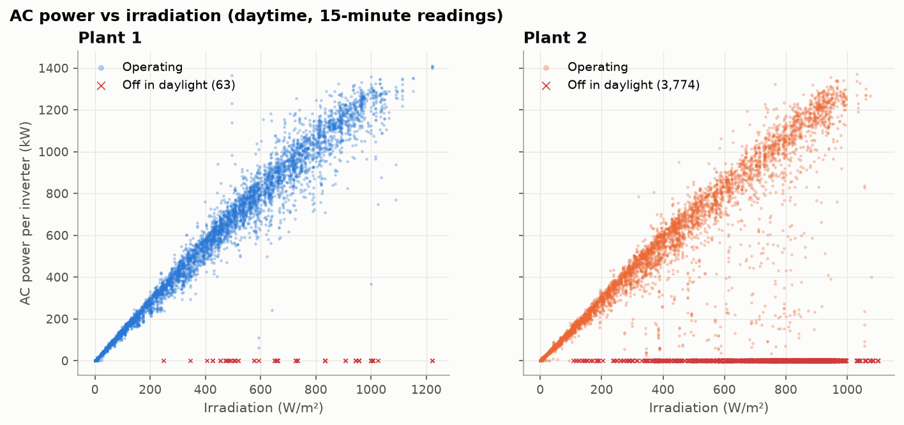

**Takeaway:** Power is almost a straight line in irradiation (operating rows: r = 0.986 Plant 1, 0.948 Plant 2); Plant 2's 3,774 'off in daylight' readings drag its overall r down to 0.66, so they must be excluded when learning expected output.

### Module temperature effect

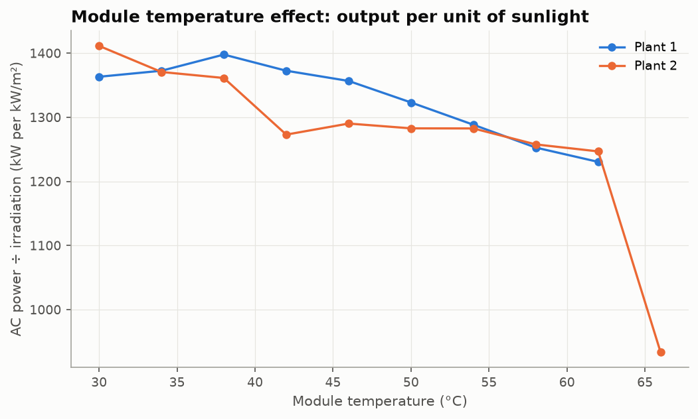

**Takeaway:** Hotter panels convert sunlight less efficiently: output per unit irradiation changes by -0.45%/°C (Plant 1) and -0.39%/°C (Plant 2), so module temperature is a useful second feature.

### Plant 1 vs Plant 2

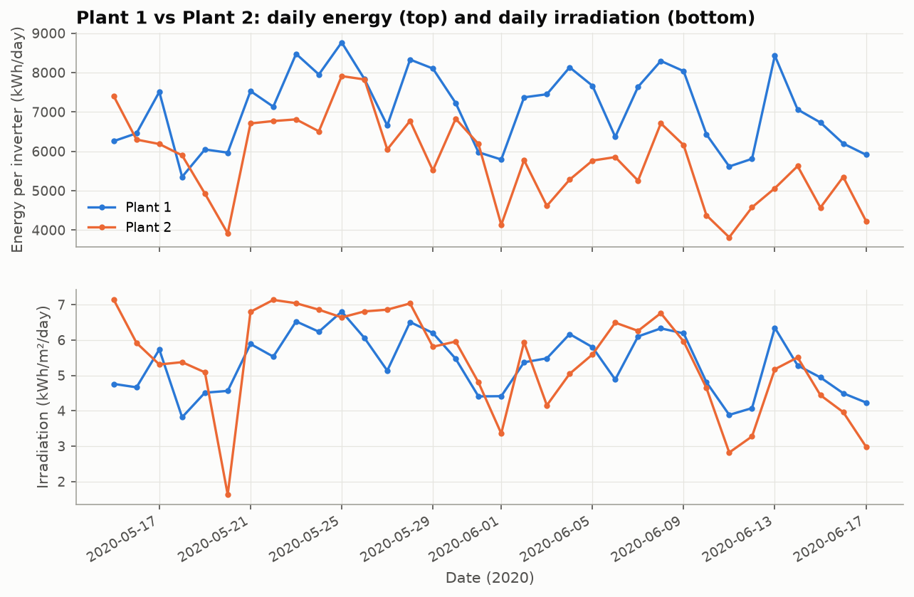

**Takeaway:** Both plants get similar sunlight (5.34 vs 5.43 kWh/m²/day), but Plant 2 produces less per inverter (5755 vs 7075 kWh/day); the gap is about performance, not weather.

### Inverter comparison

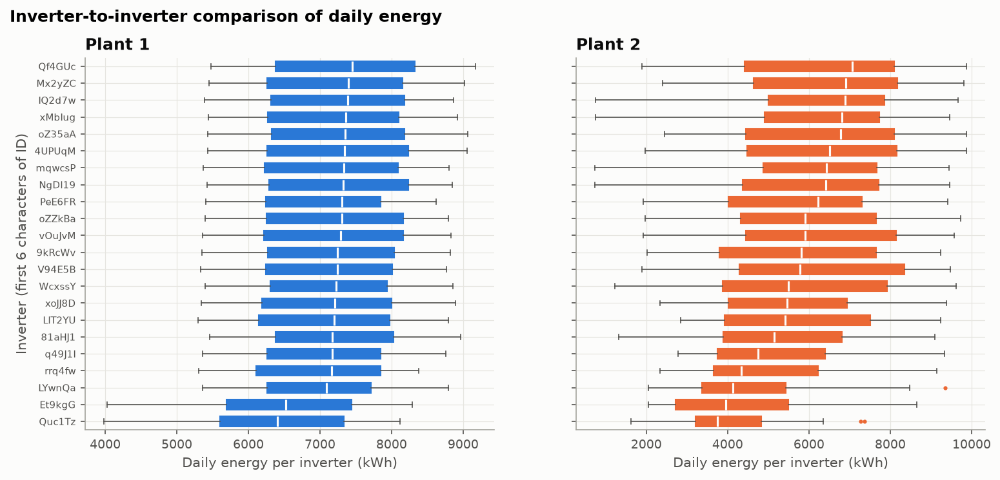

**Takeaway:** Plant 1's inverters are tightly grouped (best median only 16% above the worst); Plant 2 is far more uneven (89% gap). Its inverters are the same size (peak 1173–1385 kW) and the low ones have the most 'off in daylight' intervals (r = -0.88), so the gap is lost output, not smaller hardware.

### Inverter × day heatmap

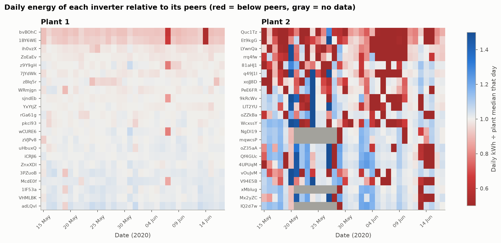

**Takeaway:** Under-performance is concentrated: 229 of Plant 2's 716 inverter-days are below 85% of the plant median vs 7 in Plant 1. They come in runs on the same inverters (persistent issues), but on 24 days many Plant 2 inverters drop together, which pulls the median down and makes healthy ones look high, so monitoring must also compare each inverter with model-expected output, not only with its peers.

### Threshold check

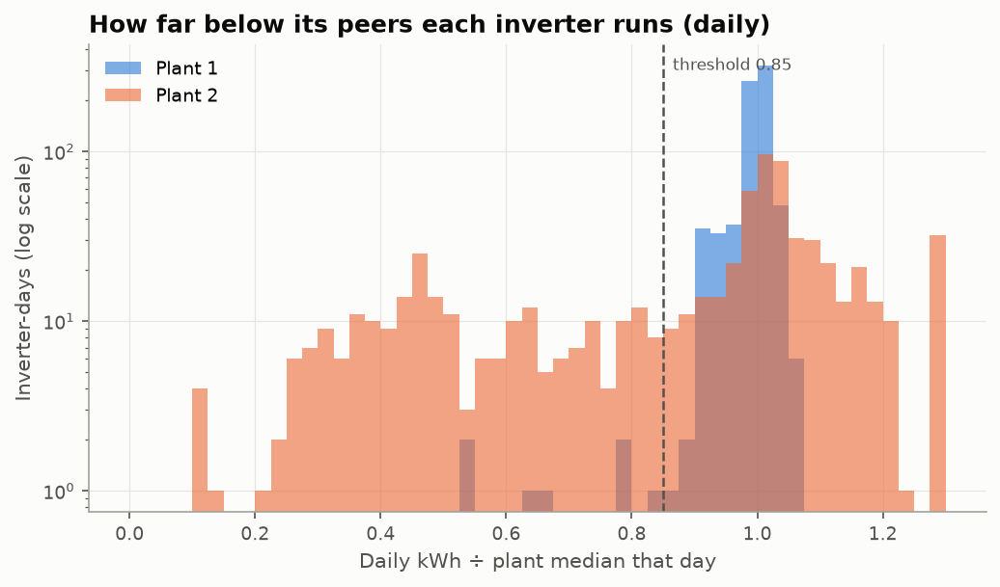

**Takeaway:** Normal days sit tightly around 1.0 (Plant 1 5th percentile 0.92), so 0.85 is well outside normal variation: it flags 0.9% of Plant 1 and 32.0% of Plant 2 inverter-days. Keeping 0.85.

## Household consumption (UCI, France)

### Daily trend

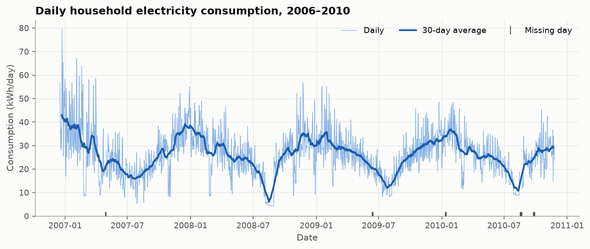

**Takeaway:** Consumption follows a clear yearly cycle: winter days (Dec–Feb) average 34.0 kWh vs 17.4 kWh in summer (Jun–Aug), 2.0× higher; there is no strong long-term trend.

### Weekday vs weekend

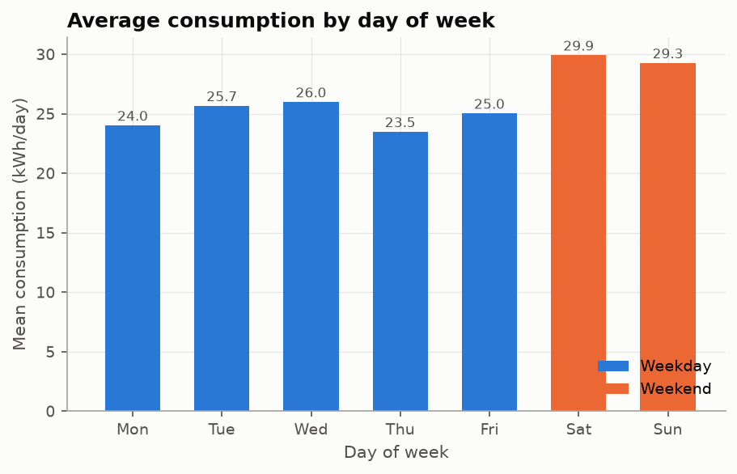

**Takeaway:** Weekend days use 29.6 kWh on average vs 24.8 kWh on weekdays (+19%), so day of week is a useful feature; the highest day is Sat.

### Monthly seasonality

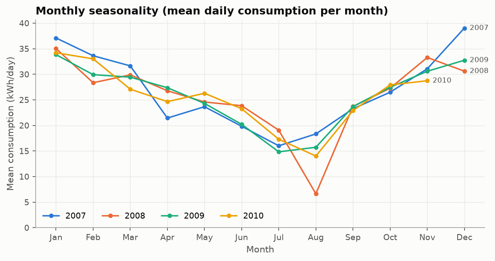

**Takeaway:** All years share a winter-high, summer-low shape: highest in Dec (35.7 kWh/day), lowest in Aug (13.7 kWh/day). August varies most between years (only 6.6 kWh/day in 2008, likely the household away on holiday), a pattern lag features alone cannot foresee.

### Sub-metering shares

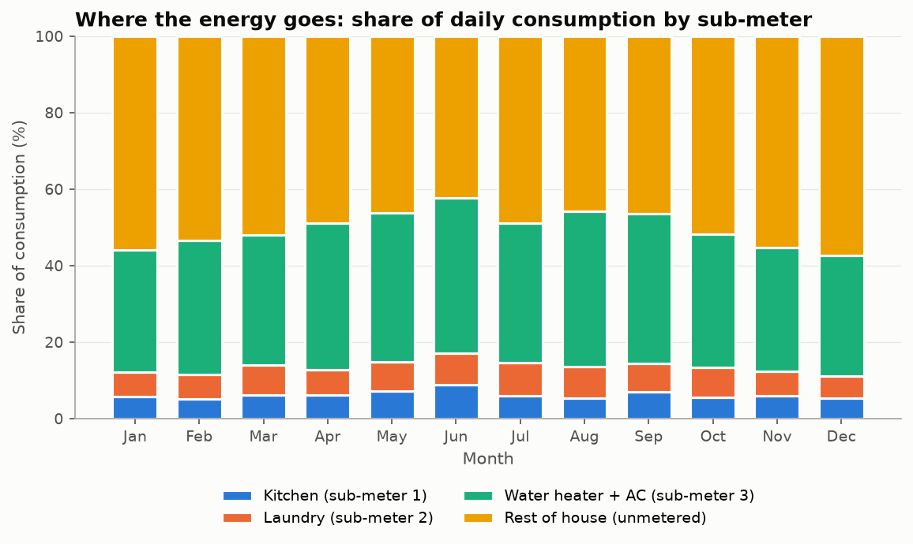

**Takeaway:** The unmetered rest of the house is the largest share (51%); the water heater + AC meter accounts for 36%, kitchen 6% and laundry 7%.

### Missing data

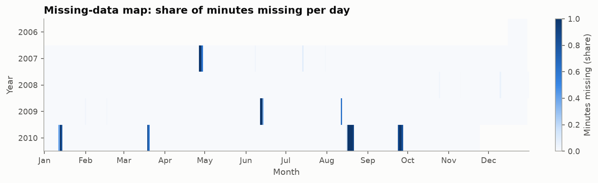

**Takeaway:** Missing data is rare and clustered: 22 of 1440 days fall below 90% coverage, mostly in a few multi-day outages (2007, 2009 and several in 2010), so only short gaps were interpolated.

### Distribution

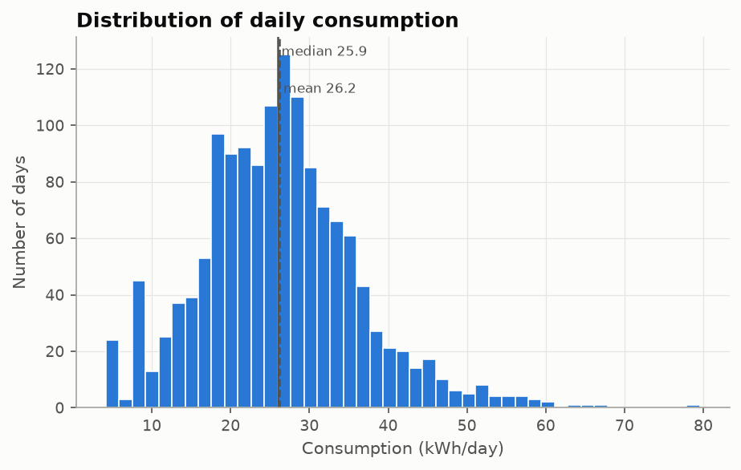

**Takeaway:** Daily consumption is right-skewed (skewness 0.57): most days use 20–32 kWh, with a tail of heavy days up to 80 kWh, so MAE is a more robust headline metric than RMSE.

### Autocorrelation

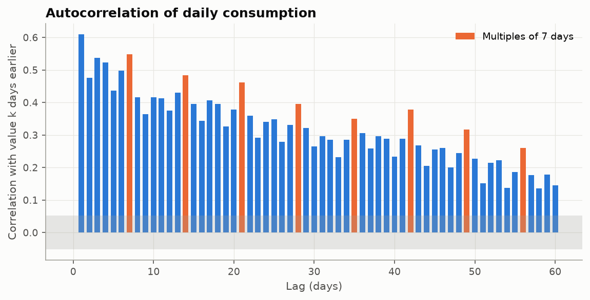

**Takeaway:** Yesterday is the strongest single predictor (r = 0.61), with bumps every 7 days (lag 7 r = 0.55, lag 14 r = 0.48); this supports lag 1, 2, 7 and 14 features and weekly rolling averages.

### Temperature effect

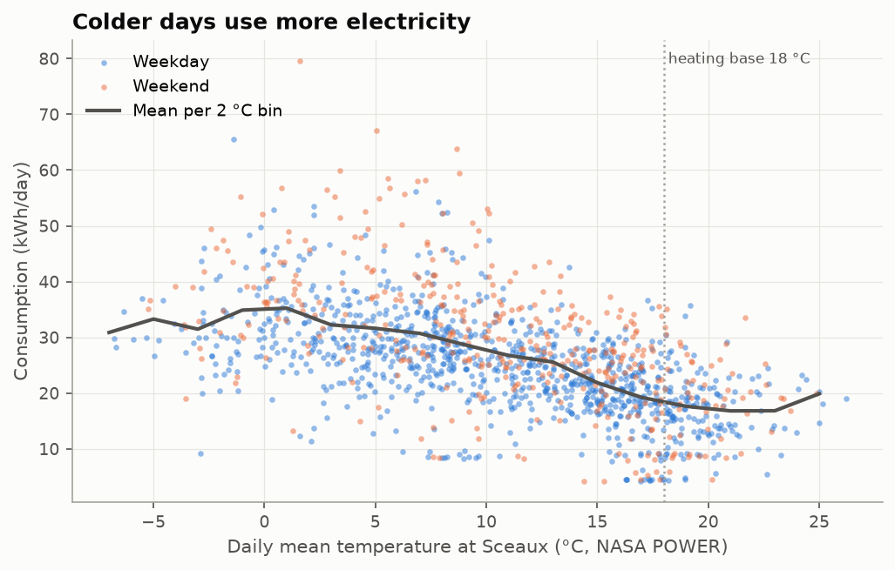

**Takeaway:** Days below 5 °C average 33.1 kWh vs 17.4 kWh above 18 °C; below the heating base each 1 °C colder adds about 0.81 kWh. Yesterday's temperature correlates r = -0.56 with consumption, which is why past temperature is now a feature.
