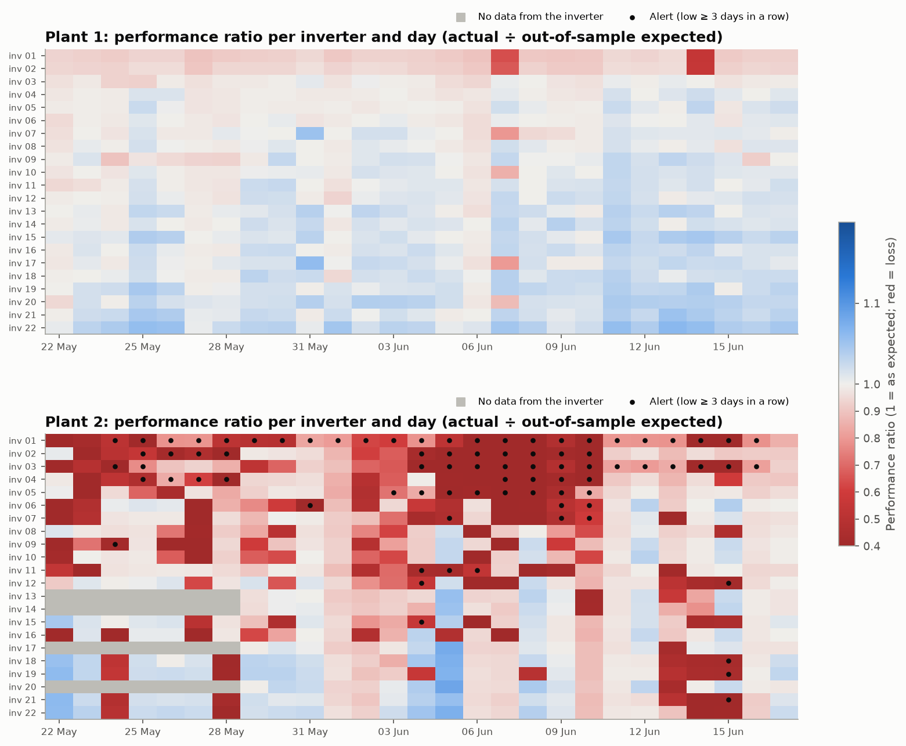
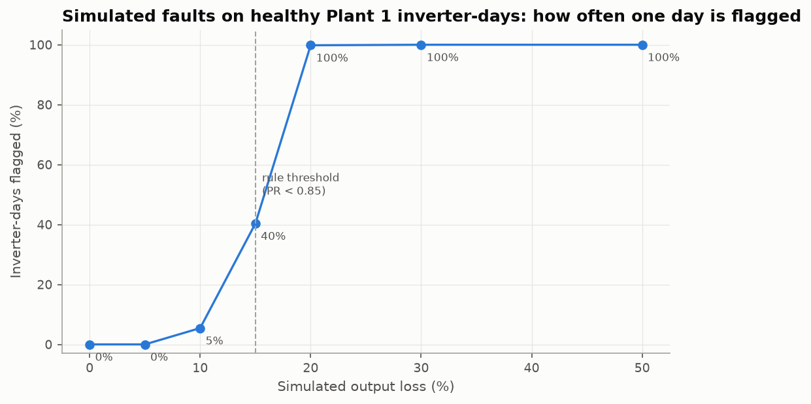
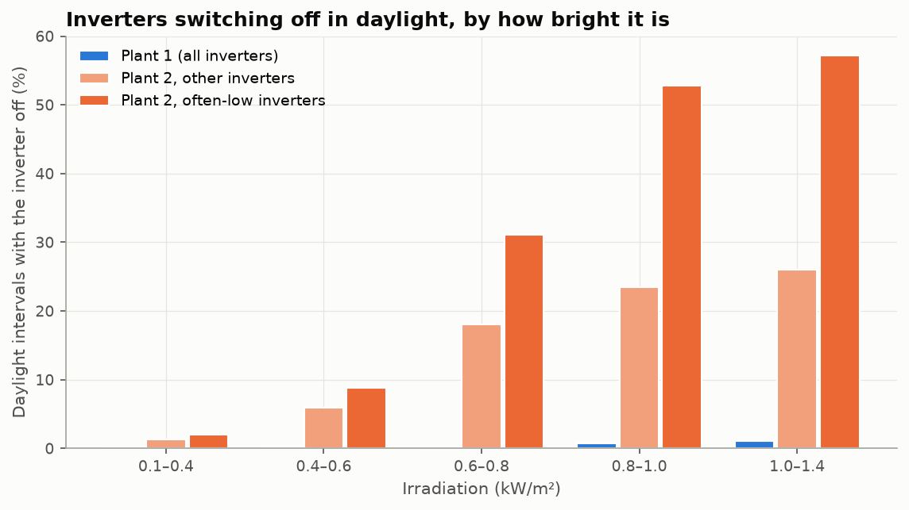
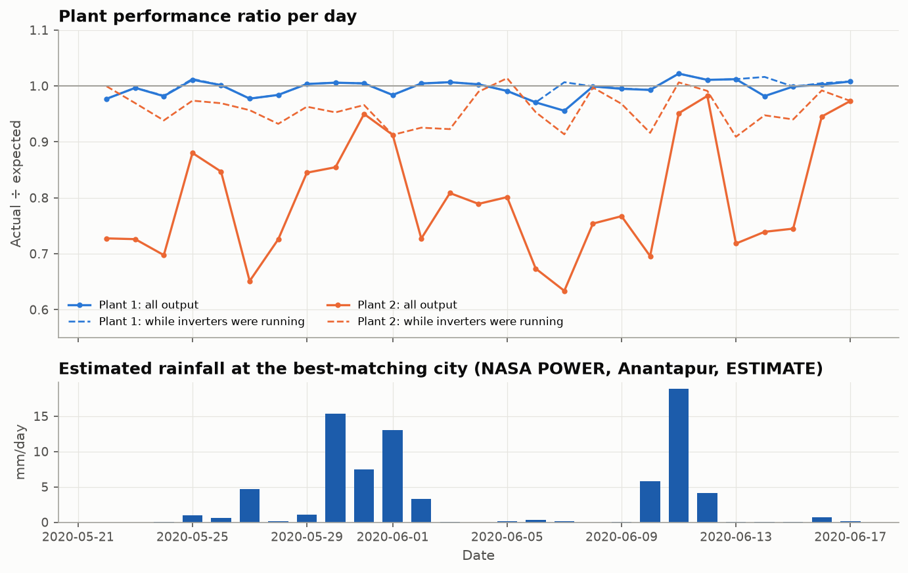

# Performance monitoring and maintenance (Phases 4C and 4D)

*Generated by `python -m solvia.pipeline --steps monitor maintenance`. All numbers are computed by the code.*

## How expected output is made (out-of-sample)

For every day the Phase 4B configuration (HistGradientBoosting, one model per plant, healthy reference) is refitted on **earlier days only** and predicts that day. The first 7 days are warm-up, so monitoring covers 2020-05-22 to 2020-06-17 (27 days), 1,160 inverter-days. Healthy inverter-days have a median PR of 1.007 (Plant 1) and 0.981 (Plant 2); 5th–95th percentile 0.942–1.038 on Plant 1.

## Rules

- **PR** = actual ÷ expected kWh per inverter-day; **low** if PR < 0.85.
- **Peer outlier** if the robust z-score among the plant's inverters that day is < -3.0 *and* PR < 0.95.
- **watch** = low or peer outlier on the day; **alert** = low for ≥ 3 consecutive days.
- **Running PR** = PR over the intervals when the inverter was on. Shutdowns lower PR but not running PR; dust lowers both.

## Status of every inverter-day

| plant | ok | watch | alert |
|---|---|---|---|
| Plant 1 | 544 | 50 | 0 |
| Plant 2 | 354 | 130 | 82 |

Inverters with at least one alert: Plant 1 0, Plant 2 14 of 22.

## Does the rule catch real faults? (simulated)

Healthy Plant 1 inverter-days with their output scaled down; one day is flagged when PR < 0.85. 0 % loss shows the false-alarm rate.

| loss_pct | inverter_days | flagged_share |
|---|---|---|
| 0 % | 570 | 0.0% |
| 5 % | 570 | 0.0% |
| 10 % | 570 | 5.4% |
| 15 % | 570 | 40.4% |
| 20 % | 570 | 99.8% |
| 30 % | 570 | 100.0% |
| 50 % | 570 | 100.0% |

A single day reliably catches losses of 20 % or more; smaller losses need the multi-day view (trend, running PR).

## Isolation Forest comparison

Isolation Forest on (PR, peer z-score, off share), set to the same flag rate as the PR rule (18.6%): both flag 198 inverter-days, rule only 18, Isolation Forest only 18 (Jaccard 0.846). Days only the rule flags have median PR 0.647; days only the forest flags have median PR 0.93. The transparent rule is kept; the forest adds little and cannot explain its flags.

## Key finding: Plant 2 loses energy by switching inverters off in bright conditions

Mean plant PR is 0.797 on Plant 2 but 0.959 while its inverters were running. Shutdowns explain 85% of Plant 2's lost energy. The shutdowns happen around midday and rise with irradiation (figure m03); Plant 1 almost never shuts down. Module temperature is the same with inverters off or on, and only a few of the 22 inverters are off at the same moment, so this is not a whole-plant outage. Likely causes are inverter trips (grid over-voltage, overload or over-temperature settings) or curtailment; the data cannot tell which, so the recommendation is to read the inverters' event logs.

## Rain effect (estimate)

Rainfall is NASA POWER at the best-matching city (Anantapur), not measured at the plant.

| plant | group | days | mean_plant_pr | mean_running_pr | mean_irradiation_kwh_m2 |
|---|---|---|---|---|---|
| Plant 1 | other days | 21 | 0.994 | 0.999 | 5.71 |
| Plant 1 | after rain | 5 | 1.005 | 1.005 | 4.43 |
| Plant 2 | other days | 21 | 0.775 | 0.957 | 5.71 |
| Plant 2 | after rain | 5 | 0.905 | 0.960 | 4.04 |

Plant 2's PR is higher after rain, but those days are also much dimmer, and dim days have fewer shutdowns. Running PR (no shutdowns) shows no link to rain (r = 0.012 Plant 2, 0.191 Plant 1). **No evidence of soiling or of rain washing in these 27 days.** With 5 rainy days this is weak evidence either way.

## Maintenance recommendations (Phase 4D)

Rules (details in `src/solvia/rules/maintenance.py`): R1 inverter offline ≥ 1.0 h in daylight · R2 inverter low ≥ 3 days while peers are fine (shutdowns → event log; steady shortfall → strings) · R3 plant-wide loss (rain decides dust vs other cause) · R4 running PR falling ≥ 0.5%/day over 10 days without rain → cleaning · R5 plant PR ≥ 1.15 → sensor check · R6 dry-month cleaning advice · R7 inverter not reporting · R0 no action.

Plant-days on which each rule fired:

| plant | R0 no_action | R1 inverter_offline | R2 inverter_underperforming | R7 not_reporting |
|---|---|---|---|---|
| Plant 1 | 25 | 6 | 0 | 0 |
| Plant 2 | 1 | 126 | 79 | 28 |

R2 fired for 14 Plant 2 inverters; type: shutdowns → event log / trip settings: 79 plant-days.

Example recommendations:

- **R1 inverter_offline** (Plant 2, inverter `81aHJ1q11NBPMrL`, 2020-05-22, high): Check the inverter (trip, fault code, AC/DC isolator). *Reason:* It produced nothing for 5.0 h while the sun was up.
- **R2 inverter_underperforming** (Plant 2, inverter `81aHJ1q11NBPMrL`, 2020-05-24, high): Read the inverter's event log for trips (grid over-voltage, over-temperature, overload) and check its trip settings and AC voltage at the terminals. *Reason:* Output was below 85% of expected for 3 days in a row (mean 50%); 56% of the plant's inverters were low today, below the 60% that would point to a plant-wide cause; it switched off for 3.7 h a day on average while the sun was up, so the loss is shutdowns, not dust.

Tables: `data/interim/monitoring_inverter_day.parquet`, `monitoring_plant_day.parquet`, `maintenance_recommendations.parquet`; metrics in `reports/metrics/monitoring_*` and `maintenance_summary.json`.
